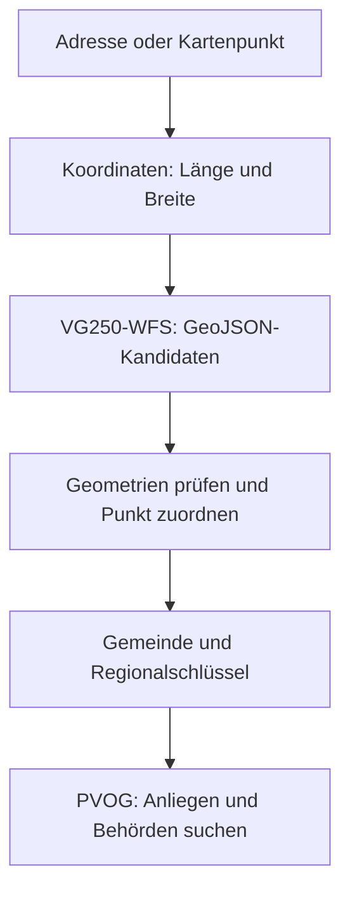

# Wie verarbeitet der Zuständigkeitsfinder WFS-Daten?

Diese Beschreibung bezieht sich auf den lokal vorliegenden Projektstand vom 13. November 2026 (Commit `43d136eec0ebceb4e418b5f4b58a7a779afbf4f2`). Der Code liegt vor allem in [`app/server.py`](../app/server.py) und [`app/static/app.js`](../app/static/app.js). Das Dokument ist für den Ordner `docs/` im Repository gedacht.

## Kurz erklärt

Die Anwendung fragt bei jeder Suche die Gemeindegrenzen in der Umgebung des ausgewählten Standorts beim BKG-Web-Feature-Service (WFS) als **GeoJSON** ab. Aus diesen Kandidaten prüft sie mit einer räumlichen Analyse, welche Gemeinde den Punkt tatsächlich abdeckt. Aus den Eigenschaften der passenden Gemeinde liest sie den **Amtlichen Regionalschlüssel (ARS)** aus. Diesen Schlüssel und das Anliegen verwendet sie, um beim Portalverbund Online-Gateway (PVOG) nach passenden Verwaltungsleistungen und den zugehörigen Behörden zu suchen.

Wichtig: Der WFS liefert im Hauptablauf **Gemeindegebiete und deren Attribute**, nicht direkt die für jedes Anliegen zuständige Behörde. Die Behördeninformationen kommen anschließend vom PVOG. Der ältere BZB-Open-Ablauf verwendet hingegen direkt Zuständigkeitsgebiete; er wird weiter unten getrennt beschrieben.



## 1. Standort bestimmen

Die Nutzerin oder der Nutzer wählt entweder einen Punkt auf der Karte oder eine Adresse aus den Ergebnissen von Nominatim beziehungsweise Photon. Der Geocoder liefert Standortvorschläge, die das Backend auf ein gemeinsames Format mit `label`, `lat` und `lon` bringt. Die Adresse selbst wird nicht an den WFS übermittelt, sondern der ausgewählte Punkt.

Das Frontend sendet die Koordinaten an `POST /api/municipalities`, zum Beispiel:

```json
{"lat": 50.0, "lon": 8.27}
```

Das Backend wandelt beide Werte in Zahlen um und akzeptiert nur `47 ≤ lat ≤ 56` und `5 ≤ lon ≤ 16`. Das ist eine grobe rechteckige Plausibilitätsprüfung für Deutschland, kein Nachweis, dass der Punkt tatsächlich innerhalb Deutschlands liegt. Bei ungültigen Werten antwortet es mit HTTP 400 und `invalid_location`.

## 2. Passende WFS-Objekte anfordern

Der Hauptablauf verwendet den BKG-Dienst `https://sgx.geodatenzentrum.de/wfs_vg250` und den Gemeindelayer `vg250:vg250_gem`. Er schickt eine WFS-2.0-`GetFeature`-Anfrage mit diesen Parametern:

| Parameter | Aktueller Wert | Zweck |
| --- | --- | --- |
| `service`, `version`, `request` | `WFS`, `2.0.0`, `GetFeature` | Vektorobjekte abrufen. |
| `typeNames` | `vg250:vg250_gem` | Gemeindegebiete auswählen. |
| `outputFormat` | `application/json` | Antwort als GeoJSON anfordern. |
| `srsName` | `urn:ogc:def:crs:OGC::CRS84` | Koordinaten im Bezugssystem CRS84 anfordern. |
| `bbox` | `lon−0.0001,lat−0.0001,lon+0.0001,lat+0.0001,CRS84` | Nur Gebiete in einem kleinen Rechteck um den Punkt abfragen. |
| `count` | `1000` | Höchstens 1.000 Objekte anfordern. |

Das Rechteck ist ein **Vorfilter**: Ein Gebiet kann das Rechteck schneiden, ohne den gesuchten Punkt selbst zu enthalten. Deshalb folgt später eine genaue Punkt-in-Fläche-Prüfung.

### Was passiert mit dem Koordinatensystem?

Der Code fordert die WFS-Antwort bereits in **CRS84** an. Darin ist die Reihenfolge eindeutig **Längengrad, Breitengrad**, zum Beispiel `[8.27, 50.0]`. Der Shapely-Punkt wird entsprechend als `Point(lon, lat)` erstellt. Die Umrechnung aus einem möglicherweise anderen Quell-Koordinatensystem wird, soweit erforderlich, vom WFS bei der Bereitstellung der angeforderten Antwort übernommen. Das Backend führt hierfür **keine eigene allgemeine CRS-Transformation** mit GeoPandas oder `pyproj` durch. Es verlässt sich darauf, dass der Dienst die angeforderten Koordinaten korrekt liefert.

## 3. Antwort einlesen und auf Vollständigkeit prüfen

`fetch_json` fordert die Daten über HTTP an und liest die Antwort mit `response.json()` in Python-Objekte ein. Erwartet wird eine GeoJSON-`FeatureCollection`, deren `features` eine Liste von Objekten ist. Jedes relevante Feature enthält eine `geometry` und üblicherweise `properties` mit den Sachattributen.

Der Code lehnt die Antwort als möglicherweise unvollständig ab, wenn `numberMatched` eine Zahl ist, die größer als die Anzahl der gelieferten Features ist, oder wenn mindestens 1.000 Features zurückgegeben wurden. In diesem Fall erfolgt **kein automatisches Paging**; die Suche endet mit `municipalities_unavailable` und HTTP 502. Ist `numberMatched` unbekannt und werden weniger als 1.000 Features geliefert, kann dieser Check allein die Vollständigkeit nicht garantieren.

Auch ein Dienstausfall, eine unerwartete Antwortstruktur oder ein Verarbeitungsfehler führt zu `municipalities_unavailable` und HTTP 502. Eine leere, ansonsten gültige Trefferliste kann dagegen ein reguläres Ergebnis sein.

## 4. Geometrien prüfen und den Punkt zuordnen

Die Funktion `matches_for_point` durchläuft die zurückgegebenen Features:

1. Sie erwartet eine vorhandene GeoJSON-Geometrie und wandelt sie mit `shapely.geometry.shape` in ein Shapely-Geometrieobjekt um.
2. Nur `Polygon` und `MultiPolygon` werden als ursprüngliche Gebietsgeometrie akzeptiert; fehlende, leere oder andere Geometrietypen führen zu einem Fehler.
3. Ist eine Geometrie ungültig, versucht Shapely `make_valid` sie zu reparieren. Bleibt das Ergebnis leer oder ungültig, wird die Anfrage abgebrochen. Bei erfolgreicher Reparatur setzt das Backend `geometry_repaired` auf `true`. Ein repariertes Objekt kann einen anderen Geometrietyp annehmen.
4. `geom.covers(Point(lon, lat))` prüft, ob das Gebiet den Punkt abdeckt. Anders als bei einem strengen „liegt im Inneren“ zählen **Punkte auf der Grenze** mit. Deshalb sind mehrere Treffer an einer Grenze möglich.
5. Bei einer Reparatur ersetzt `mapping(geom)` im jeweiligen Feature die Geometrie durch die reparierte Fassung. Somit ist im älteren BZB-Ablauf eine zurückgegebene Geometrie dieselbe, die für den Test verwendet wurde. Im Hauptablauf wird die Fläche selbst nicht an das Frontend zurückgegeben.

`geometry_repaired` meldet, ob **irgendeine geprüfte Kandidatengeometrie** repariert wurde, nicht zwingend die letztlich ausgewählte Gemeinde. Die Oberfläche weist bei gesetztem Flag darauf hin, das Ergebnis insbesondere an Grenzen zu prüfen.

## 5. Attribute auf ein einheitliches Ausgabeformat reduzieren

Für jedes passende Gemeinde-Feature liest das Backend die `properties` und erstellt daraus einen Eintrag:

| WFS-Attribut | Ausgabe | Verarbeitung |
| --- | --- | --- |
| `ars` | `ars` | Wird nur übernommen, wenn es sich um eine Zeichenkette mit genau zwölf Ziffern handelt. Fehlende oder ungültige Werte werden übersprungen; führende Nullen bleiben erhalten. |
| `gen` | `name` | Gemeindename; fehlt er, wird der ARS als Ersatz verwendet. |
| `lkz` | `state` | Landeskennung; wenn nicht vorhanden, eine leere Zeichenkette. |

Mehrere passende Features mit demselben ARS werden auf einen Eintrag reduziert. Weitere WFS-Attribute und die Gemeindegeometrie werden in dieser Antwort nicht ausgegeben.

Ein **schematisches Beispiel** für die Antwort ist:

```json
{
  "places": [
    {"ars": "073150000000", "name": "Mainz", "state": "RP"}
  ],
  "geometry_repaired": false
}
```

Bei keinem verwendbaren Treffer zeigt die Oberfläche an, dass keine Gemeinde gefunden wurde. Bei genau einem Eintrag verwendet sie ihn direkt. Bei mehreren Einträgen lässt sie die Nutzerin oder den Nutzer eine Gemeinde auswählen.

## 6. Übergabe an den Portalverbund

Das Frontend sendet den ausgewählten `ars` zusammen mit dem Suchbegriff an `POST /api/services`. Das Backend prüft den zwölfstelligen Schlüssel erneut und fragt die PVOG-Suche mit Anliegen und ARS ab; `useArsHierarchy=true` berücksichtigt die vom PVOG unterstützte ARS-Hierarchie. Die Ergebnisse werden seitenweise zu je acht Leistungen abgerufen.

Nach Auswahl einer Leistung fragt `POST /api/service-detail` weitere Informationen und bis zu fünf zugeordnete Organisationen beim PVOG ab. Diese Daten werden gesondert für die Oberfläche aufbereitet, etwa indem HTML in Text umgewandelt und zulässige Links gefiltert werden. Das ist eine Verarbeitung von **PVOG-Daten**, keine Transformation der WFS-Flächen.

## Separater Pfad: BZB-Open

Die älteren Endpunkte `/api/layers` und `/api/lookup` sowie das Notebook [`notebooks/explore_bzb.ipynb`](../notebooks/explore_bzb.ipynb) verwenden `https://sgx.geodatenzentrum.de/wfs_bzb_open`. Dieser Pfad ist **nicht** die VG250/PVOG-Hauptsuche der aktuellen Oberfläche.

- `/api/layers` liest per `GetCapabilities` die verfügbaren Layer und beschränkt sie auf sieben im Code bekannte Layer; bei einem Fehler gibt es diese sieben als Fallback zurück.
- `/api/lookup` fragt für einen ausgewählten erlaubten Layer mit CRS84, kleiner Bounding Box und `count=1000` GeoJSON ab. Dieselbe Shapely-Funktion prüft und repariert Kandidaten und ermittelt mit `covers` die Treffer. Die API gibt eine `FeatureCollection` mit passenden Features und `geometry_repaired` zurück.
- Das Notebook verwendet für ein Beispiel in Mainz zusätzlich OWSLib, GeoPandas und Folium: Es liest die Features in einen `GeoDataFrame` mit CRS84, repariert ungültige Geometrien, prüft `covers` und stellt Treffer auf einer Karte dar. Das Setzen des CRS beim Einlesen ist dabei **keine eigene Koordinatentransformation**.

## Grenzen und praktische Bedeutung

- **VG250 sind generalisierte Verwaltungsgrenzen.** Gerade nahe einer Grenze kann die Zuordnung von genaueren oder aktuelleren Grenzen abweichen.
- **Gemeinde ist nicht gleich vollständige Zuständigkeit.** Sonderregeln, unterschiedliche Behördenbezirke und Lücken im PVOG können das Ergebnis beeinflussen.
- **Reparaturen können Flächen verändern.** Das Kennzeichen macht diesen Umstand sichtbar, garantiert aber keine fachliche Korrektheit.
- **Keine lokale Datenbank oder dauerhafte WFS-Aufbereitung:** Der Hauptablauf verarbeitet die abgefragten WFS-Daten bei der Suche im Arbeitsspeicher; ein dauerhaftes Import- oder ETL-Verfahren ist im beschriebenen Code nicht implementiert.
- **WMS und WFS haben unterschiedliche Aufgaben:** TopPlusOpen-WMS liefert im Frontend das Hintergrundbild; die analysierbaren Gemeindegeometrien kommen vom WFS. Die Hauptsuche zeichnet die zurückgegebenen Gemeindegeometrien nicht als eigene Ebene ein.

Weitere Hinweise zu Herkunft, Lizenz und Datenstand stehen in [`docs/data-sources.md`](data-sources.md); der Gesamtaufbau steht in [`docs/architecture.md`](architecture.md).
