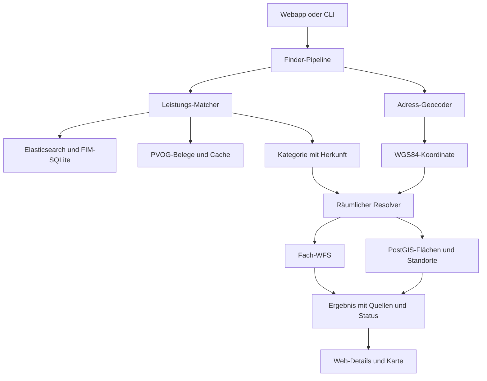

# Architektur des finalen LeBeZi-Standes

Die Anwendung ist ein Monorepository mit drei separat installierbaren Python-Paketen. Eine gemeinsame virtuelle Umgebung reicht aus. Die finale Weboberfläche liegt in `behoerden-finder/src/behoerden_finder/web/static/`; das Backend verwendet `ThreadingHTTPServer` aus der Python-Standardbibliothek. Es gibt keinen separaten Frontend-Build und keinen eigenen GeoServer.

## Zuständigkeiten der Pakete

| Baustein | Zentrale Dateien | Verantwortung |
| --- | --- | --- |
| Matcher | `authority_matcher/autorun.py`, `index.py`, `matcher.py`, `pvog_live.py`, `jzufi.py` im Matcher-Paket | Katalogsuche, Indexpflege, PVOG-Abgleich, Belege und Kategorie-Ranking |
| Finder | `pipeline.py`, `matching.py`, `faelle.py`, `themen.py`, `geocode.py` | Verknüpfung der Bausteine, redaktionelle Ergänzungen, Geocodierung, Ergebnisstatus |
| Web-Backend | `web/__init__.py`, `leistung_details.py`, `zusatz_quellen.py`, `osm_details.py`, `google_places.py` | HTTP-API, statische Dateien, Leistungs- und Behördeninformationen |
| Resolver | `resolver.py`, `wfs.py`, `etl.py`, `db.py`, `mappings.py` | Räumliche Fachabfrage, geprüfte Importe, gesetzliche Zuordnungen und Standortergänzung |

Die Paketnamen unterscheiden sich: Der Matcher wird als `authority_matcher` importiert, der Finder als `behoerden_finder`, der Resolver als `behoerden_resolver`. Die frühere gleichnamige `authority_matcher/`-Implementierung im Repository-Hauptordner wurde entfernt; sie hatte den finalen Matcher beim Start aus dem Hauptordner verdeckt.

## Fachliche Zuordnung

Der Matcher rankt importierte FIM-Leistungen mit BM25 und optional `intfloat/multilingual-e5-small`. Für passende LeiKa-Schlüssel werden regionale PVOG-Leistungsbeschreibungen, JZuFi-Relationen und Organisationstitel ausgewertet. Referenz-ARS dienen der Datenbeschaffung; sie sind kein Ersatz für den Nutzerstandort. Die Taxonomie ist projektspezifisch und umfasst 36 Kategorien.

Der Finder ergänzt den Fallkatalog aus `faelle_daten.py` und Themenregeln aus `themen.py`. Starke redaktionelle Falltreffer können standardmäßig auch einen amtlich belegten Matcher-Vorschlag überschreiben. `--matcher-vorrang` ändert diese Priorität. Herkunft und Warnungen stehen in den Pipeline-/CLI-Ergebnissen. Die aktuelle Web-Dekoration entfernt bestimmte interne Herkunftshinweise; die Oberfläche zeigt daher nicht alle diagnostischen Informationen der CLI.

Der Fallkatalog verwendet die SQLite-Tabelle `faelle`. Die FIM-/PVOG-Tabellen und eigene Katalogeinträge mit anderer Herkunft bleiben bei seiner Pflege erhalten. Matcher-Scores messen Rangfolge und Eindeutigkeit, keine statistisch kalibrierte Sicherheit.

## Räumliche Auflösung

`auto` nutzt passende Fach-WFS und lokale Ergänzungen. `local` verwendet den importierten PostGIS-Bestand. Der Resolver prüft Polygone einschließlich Löchern und Grenzen (`ST_Covers` bzw. entsprechende Geometrieprüfung). Wo konfiguriert, können belegte Aufgaben-Zuordnungen eine bereits benannte Verwaltung als Anlaufstelle liefern; die Antwort enthält Regel und Belegstufe.

Fehlen danach passende Flächen, können nahe Standortpunkte angeboten werden. Diese haben keine behauptete Zuständigkeitsfläche. Ein WFS-Ausfall wird nicht still als Abdeckungslücke gewertet. Ortsunabhängige und vom persönlichen Kontext abhängige Kategorien behalten eigene Statuswerte. Die Zuordnungstabelle steht in `resources/category_mappings.json`; der aktuelle Bestand in der Resolver-Abdeckungsdokumentation.

## Datenhaltung und Integrationen

FIM, PVOG-Belege, Fallkatalog und Indexmanifeste liegen außerhalb des Repositories unter `AUTHORITY_MATCHER_HOME`. Elasticsearch und PostGIS speichern in separaten Docker-Volumes. Der Resolver hält reproduzierbare normalisierte Snapshots mit Manifesten im Repository. Zugangsbeschränkte BZB-Dateien und daraus erzeugte Snapshots bleiben lokal und ignoriert.

Die Pipeline ist über `Finder.find(...)` direkt aufrufbar und liefert ein Python-Dictionary. Webapp und CLI verwenden dieselbe fachliche Kette. Ein MCP-Transport ist in diesem Repository nicht implementiert. Die HTTP-Schnittstellen sind in [web-api.md](web-api.md) beschrieben.
