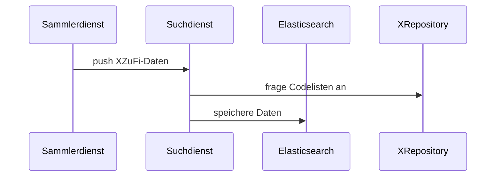

[//]: # "Diese Datei basiert auf dem README-Template in Version 1.0.0"

<div align="center">


# PVOG • Suchdienst

Der Suchdienst ist ein auf Spring Boot basierender Webdienst und eine Kernkomponente des Portalverbunds. Er macht Verwaltungsleistungen für externe Konsumenten anwendergerecht durchsuchbar und stellt dazu REST-APIs für Suchanfragen bereit.

[Demo](#-demo) • [Schnellstart](#-schnellstart) • [Support](#-support)

</div>

---

## 📋 Inhalt

- [Überblick](#-überblick)
- [Demo](#-demo)
- [Schnellstart](#-schnellstart)
- [Verwendung](#-verwendung)
- [Entwicklung](#️-entwicklung)
- [Lizenz](#-lizenz)
- [Support](#-support)
- [Links](#-links)

---

## 🌟 Überblick

Der Suchdienst aggregiert die von den Redaktionssystemen von Bund und Ländern erhaltenen Verwaltungsleistungen und Zuständigkeiten und stellt sie über eine REST-API zur Verfügung. Die XZuFi-Geschäftsobjekte werden in Elasticsearch effizient durchsuchbar dauerhaft gespeichert.

Die in Elasticsearch indizierten standardisierten Verwaltungsleistungen (aus XZuFi) werden über dedizierte Endpunkte für Endanwender, sowie nachnutzende Systeme auffindbar gemacht. Dabei trennt der Suchdienst die Rohdaten (JZuFi, XZuFi) von den nach Redaktionssystem aggregierten und suchoptimierten Modellen (Verwaltungsleistungen).

### Hauptmerkmale

- Support für XZuFi in Version 2.2.0 und 2.3.1: Parallele Unterstützung von beiden Versionen, um die Migration der Redaktionssysteme zu erleichtern
- REST-API: Umfangreiche Schnittstellen für den Datenabruf
- Suchen und Filtern: Umfangreiche Möglichkeiten zum Suchen und Filtern der Redaktionssystem-Daten
- Primary-Secondary-Architektur: Trennung von Lese- und Schreibvorgängen für Skalierbarkeit und Ausfallsicherheit
- Redis-Caching: Performance-Optimierung durch effizientes Caching von Codelisten und Geoinformationen

### Hinweis zur Veröffentlichung auf openCode

Dieses Repository wird regelmäßig von einer internen Quelle auf openCode synchronisiert, um Transparenz zu gewährleisten und die Zusammenarbeit mit der Community zu ermöglichen.
Es werden der vollständige Quellcode sowie unterstützende Dokumentation und Konfigurationen bereitgestellt.
Aus Sicherheitsgründen bleiben jedoch sensible Informationen wie produktionsrelevante Konfigurationen und CI/CD-Skripte ausgenommen.
Bei fehlenden Informationen oder Fragen kontaktieren Sie uns gerne.

---

## 🎬 Demo

- Dokumentation und Anwendungsbeispiele der Suchdienst-API: https://pvog.fitko.net/suchdienst/api/swagger-ui/index.html
- Suchfrontend mit Anbindung an die Suchdienst-API: https://pvog.fitko.net/

---

## 🚀 Schnellstart

### Voraussetzungen

- Java 25 und Maven 3.8+
- Docker und Docker Compose (für containerisierte Abhängigkeiten)
- Elasticsearch 9.x
- Keycloak (oder Start mit `security_off` Profil)

**Maven Registry konfigurieren:**

Einige externe Abhängigkeiten sind nicht über Maven Central verfügbar. Fügen Sie die openCode-Registry zu Ihrer Maven-Konfiguration hinzu. Ein Konfigurationsbeispiel finden Sie in [opencodeSettings.xml](opencodeSettings.xml).

> Wichtig: Authentifizierungsinformationen müssen mit entsprechenden Zugangsdaten ergänzt werden.
> Siehe [Gitlab-Doku](https://docs.gitlab.com/user/packages/maven_repository/) für Details.

### Lokal mit Maven

Zur Ausführung erforderliche Abhängigkeiten müssen entweder lokal installiert oder über Docker bereitgestellt werden.

**Abhängigkeiten starten (Docker):**

```bash
docker compose --profile development up
```

Die Services (Elasticsearch, Kibana, Redis, etc.) werden gestartet. Wichtige Endpunkte:

- Elasticsearch: http://localhost:9200
- Kibana: http://localhost:5601
- Redis: tcp://localhost:6379

> Hinweis: `docker-compose.yml` reserviert 8G RAM für Elasticsearch. Passen Sie die Werte ggf. an.
> Siehe [docker-compose.yml](docker-compose.yml) für Konfiguration.

**Anwendung starten (Maven):**

Es gibt die Profilgruppen `production`, `development` und `integration-test`. Ohne explizite Profilangabe startet die Anwendung mit `development`.

```bash
mvn clean install
mvn spring-boot:run
```

### Spring Profile

Für die Entwicklung wird die Anwendung mit dem `development` Profil gestartet. Dieses aktiviert das `security_off` Profil und ermöglicht API-Zugriff ohne Keycloak-Authentifizierung. Das Profil `default` enthält dabei die Standard-Konfigurationen und muss immer mit angegeben werden. Eine Übersicht über Profilgruppen und Profile ist in der `application.yaml` zu finden.

## 💻 Verwendung

### Swagger-UI

Nach erfolgreichem Start der Anwendung finden Sie eine Dokumentation der Endpunkte in der Swagger-UI unter [http://localhost:8080/swagger-ui/index.html](http://localhost:8080/swagger-ui/index.html). Die Endpunkte können dort auch direkt ausprobiert werden.

### HTTP-Skripte

Im Verzeichnis [`http/`](http/) befinden sich zusätzlich Dateien zum manuellen Testen der Endpunkte. Diese sind mit dem [HTTP-Client von IntelliJ IDEA](https://www.jetbrains.com/help/idea/http-client-in-product-code-editor.html) sowie mit [VS Code REST Client](https://marketplace.visualstudio.com/items?itemName=humao.rest-client) kompatibel.

**Dateien**

| Datei                                                               | Beschreibung                                                                                |
| ------------------------------------------------------------------- | ------------------------------------------------------------------------------------------- |
| [`requests.http`](http/requests.http)                               | Enthält die HTTP-Anfragen zum Testen der Endpunkte                                          |
| [`http-client.env.json`](http/http-client.env.json)                 | Umgebungsvariablen (z. B. Keycloak-URL, Client-ID) – kann ins Repository eingecheckt werden |
| [`http-client.private.env.json`](http/http-client.private.env.json) | Sensible Umgebungsvariablen (z. B. `CLIENT_SECRET`) – **nicht ins Repository einchecken**   |

**Enthaltene Anfragen**

1. **Keycloak-Token abrufen** – Ruft ein OAuth2-Token via `client_credentials` ab und speichert es als `auth_token` für Folge-Anfragen.
2. **`POST /admin/verwaltungsleistung/calculate/all`** – Startet die Neuberechnung aller Verwaltungsleistungen (mit optionalem Parameter `updateLeistungskatalog`).

**Umgebung konfigurieren**

Die Datei `http-client.env.json` definiert Umgebungen (z. B. `local`). Sensible Werte (wie z. B. `CLIENT_SECRET`) werden in der Datei `http-client.private.env.json` abgelegt. Diese darf auf keinen Fall eingecheckt werden und ist deshalb in die `.gitignore`eingetragen.

Beispiel `http-client.env.json`:

```json
{
    "local": {
        "KEYCLOAK_URL": "http://localhost:8089/auth/realms/pvog/protocol/openid-connect/token",
        "CLIENT_ID": "pvog_testclient"
    }
}
```

Beispiel `http-client.private.env.json` (nicht einchecken!):

```json
{
    "local": {
        "CLIENT_SECRET": "<geheimes-client-secret>"
    }
}
```

#### Nutzung in IntelliJ IDEA

1. Datei `http/requests.http` öffnen.
2. Oben bei `Run with:` die Umgebung auswählen (z. B. `local`).
3. Den gewünschten Request per Klick auf das grüne Ausführen-Symbol starten.
4. Das Token-Request muss einmalig ausgeführt werden, bevor authentifizierte Anfragen gestellt werden können.

---

## 🛠️ Entwicklung

Dieses Kapitel enthält weiterführende Informationen zum Projekt.

### 🏗️ Architektur

Der Suchdienst empfängt Daten vom Sammlerdienst in Form des XZuFi-Standards und legt diese in Elasticsearch zum Suchen ab. Zu Entwicklungs- und Testzwecken ist es auch möglich, XZuFi direkt über die REST-API hochzuladen.

Indizierungsprozess:



#### Indizes

Das Backend speichert alle Daten in Elasticsearch in verschiedenen Indizes.

**Achtung**: Die unten stehenden Namen der Indizes sind symbolisch. Die tatsächlichen Namen entsprechen dem Schema `suchdienst_<name><version>` und ändern sich daher durch Index-Updates. In Elasticsearch finden sich daher ggf. auch mehrere Versionen eines Index.

##### XZuFi Nutzdaten

Die eigentlichen XZuFi-Daten werden in drei verschiedenen Indizes abgelegt:

- `Leistungen`: Enthält die Leistungsbeschreibungen (kurz LB). Jede Leistung entspricht einem Dokument in diesem Index. Die LB enthält außerdem die Zuständigkeiten, d.h. eine Liste von IDs von Organisationseinheiten (kurz OE) sowie die Menge der ARS, für die die OE diese Leistung verrichtet.
- `Organisationseinheiten`: Enthält die Organisationseinheiten. Wird nicht zum Suchen benutzt, sondern nur zum Laden der OEs anhand ihrer ID.
- `Spezialisierungen`: Enthält die Spezialisierungen. Wird (momentan) auch nur zum Laden anhand von ARS und ID einer LB verwendet.

Die IDs in diesen Indizes entsprechen den IDs, die auch der BeD verwendet.

Der Aufbau der Dokumente entspricht nicht dem XZuFi-Aufbau, sondern ist auf

- gute Such- und Indizierungsperformance, und
- leichte Darstellung in Clients ausgelegt.

##### Weitere Daten

Folgende Indizes enthalten weitere Daten, die das Backend benötigt, die aber nicht aus den XZuFi-Daten entnommen werden:

- `Ars`: enthält die Ortsnamen aller deutschen Gemeinden mit zugehöriger ARS für die Ortssuche. Datenbasis ist momentan `GV100` vom Statistischen Bundesamt sowie HK-DE vom BKG.
- `Codelistentries`: Speichert die Codelisten für das Auflösen von Codes. Das Backend versucht, fehlende Codelisten automatisch von https://www.xrepository.de zu laden, sie können aber auch über die API hochgeladen werden.
- `Settings`: Speichert Metadaten für die Steuerung des Backends, insbesondere den Synchronisationsfortschritt vom BeD.
- `Updatehistory`: Verwaltet die ausgeführten Indexaktualisierungen (ähnlich wie Liquibase, siehe unter "Index Evolution").

##### Grundlegende Überlegungen beim Index-Design

- Es werden nur die Felder durchsuchbar gemacht, die tatsächlich für Suchen benötigt werden. Dadurch werden die Indizes möglichst klein gehalten, was die Indizierungsperformance verbessert.
- Es muss beim Index-Design manchmal abgewogen werden, ob eine gute Indizierungsperformance oder eine gute Suchperformance wichtiger ist. Generell sollte die Suchperformance eher im Vordergrund stehen.

#### Clustering - Master vs. Slave

Um Hochverfügbarkeit und Skalierung zu ermöglichen, kann das Backend in mehreren Instanzen betrieben werden.

Dazu wird zwischen Master und Slave-Instanzen des Backends unterschieden. Pro Elasticsearch Cluster **muss exakt ein Master** betrieben werden. Nur der Master kann Veränderungen am Index vornehmen, also Daten indizieren oder Konfigurationsänderungen durch das Backoffice entgegennehmen.

Zusätzlich **können mehrere Slaves** betrieben werden, die nur Suchen ausführen. Such-Clients können über LoadBalancer an die Slaves angebunden werden, um eine höhere Verfügbarkeit zu erreichen.

##### Rolling Updates

Beim Starten prüft der Master, ob die Indexstrukturen in Elasticsearch auf dem aktuellen Stand sind und führt ggf. Indexupdates durch. Muss ein Index aktualisiert werden, wird eine neue Version des Index erstellt und die Daten aus der alten Indexstruktur übernommen. **Die alten Daten bleiben zunächst erhalten**. Auf dieser Basis können die Backend-Instanzen nacheinander aktualisiert werden, so dass durchgehend Suchanfragen beantwortet werden können.

1. Aktualisierung des Masters. Beim Start werden die Indexstrukturen aktualisiert. Die noch laufenden Slaves beantworten Suchanfragen weiterhin auf Basis der vorherigen Indexstruktur.
2. Der wieder laufende Master fährt mit der Verarbeitung von Sammlerdienst-Nachrichten fort, aktualisiert aber nur die neuen Indexstrukturen. Für einen kurzen Zeitraum kann es dazu kommen, dass Suchen auf veralteten Daten ausgeführt werden (insbesondere abhängig von der Dauer der Indexaktualisierung).
3. Sobald der Master wieder online ist, können der Reihe nach alle Slaves aktualisiert werden. Neue Slave-Versionen beantworten Suchanfragen dann wieder auf den aktuellen Indexstrukturen

#### API-Dokumentation mit OpenAPI/Swagger

Die API-Dokumentation wird aus den Annotationen im Code generiert. Dabei gibt es eine Dokumentation für interne Schnittstellen, die nicht von außerhalb sichtbar sein soll, und eine Dokumentation für externe Schnittstellen, die auch von außerhalb sichtbar sein soll. Über Profile wird gesteuert, welche Schnittstellen in der internen Dokumentation und welche Schnittstellen in der externen Dokumentation angezeigt werden sollen.

Die Profilgruppe `development` sowie das Profil `openapi_show_internal` zeigen auch die internen Schnittstellen mit in der Dokumentation an. Die Einstellungen, welche Schnittstellen intern und extern sind, werden in der Klasse `OpenApi` vorgenommen. In der Demoumgebung wird der Suchdienst so gestartet, dass die Swagger-Seite mit der generierten Doku aktiv ist und diese wird auch live auf der Landingpage eingebunden. Wenn Schnittstellen neu hinzugefügt, gelöscht oder geändert werden muss die Doku entsprechend angepasst und geprüft werden. Beim Aktualisieren der Versionen von Swagger/OpenAPI soll sichergestellt werden, dass die Einbindung der Doku in die Landingpage weiterhin funktioniert.

#### Index Evolution

Für die Index-Evolution ist organisatorisch zu prüfen, welche Versionen des Suchdienstes in den Umgebungen Demo, Preprod und Prod deployt sind. Des Weiteren sind angebundene Systeme zu informieren, wenn der Suchdienst eine Migration durchführt, die dazu führt, dass über einen längeren Zeitraum keine Daten aktualisiert werden können.

Das Aktualisieren der Indizes wird beim Start des Suchdienstes durchgeführt. Solange die Indizes aktualisiert werden ist die betreffende Instanz des Suchdienstes nicht erreichbar. Tritt bei einem der durchzuführenden Updates ein Fehler auf, dann wird der Start des Suchdienstes abgebrochen. Nach dem Aktualisieren der Indizes kann über die `IndexConfiguration` ausgelesen werden, wie die neuen Indizes, gegen die die Abfragen durchgeführt werden müssen, heißen.

Die Updates der Indizes werden über die `UpdateConfiguration` gesteuert. Dort gibt es Listen mit IndexDescriptions zum Erstellen, Migrieren und Löschen von Indizes. Die einzelnen Updateschritte müssen dort manuell hinzugefügt, bzw. wieder entfernt werden. Wenn Migrationsschritte auf den vorhandenen Systemen nicht mehr benötigt werden, sollten die Migrationsklassen entsprechend gelöscht werden.

Zuerst wird das Erstellen der Indizes durchgeführt. Dabei wird der Index immer auf eine bestimmte Zielversion gebracht. Die IndexDescriptions, die einen Index erstellen sollen von der Klasse `DefaultDescription` ableiten. Für jeden Index soll es nur eine IndexDescription zum Erstellen des Indexes geben.

Im zweiten Schritt werden die Daten aus dem alten in den neuen Index migriert. Hier kann es je nach vorhandenen Versionen in Demo, Preprod und Prod mehrere mögliche Migrationspfade geben. Eine IndexDescription zur für die Migration leitet von der Klasse `IndexMigrationDescription` ab. Dort wird die Zielversion des Indexes angegeben sowie die Version, die vorausgesetzt wird.

Beispiel zur Datenmigration:
In Demo ist der Leistungsindex in Version 2 vorhanden. In Preprod und Prod ist der Leistungsindex noch auf Version 1. Der Suchdienst wird aber nicht weiter auf Preprod und Prod deployt. Wird jetzt eine Version 3 des Leistungsindexes benötigt, dann muss es Migrationsschritte von Version 1 auf 3 und von Version 2 auf 3 geben.

Im dritten Schritt werden schließlich nicht mehr benötigte Indizes gelöscht. Dafür muss lediglich das Interface `IndexUpdateDescription` implementiert werden.

Zusammenfassung:

- Es gibt Defaultbeschreibungen, die für das Erstellen der Indizes zuständig sind
- Für einen Index gibt es immer eine Zielversionsnummer
- Es gibt Migrationsbeschreibungen, welche die Daten von einer alten Versionsnummer in die aktuelle Versionsnummer überführen
- Es gibt Löschbeschreibungen, welche am Ende der Migration alte Indizes löschen

### Code-Formatierung

Für ein einheitliches Erscheinungsbild und bessere Lesbarkeit des Codes wird [Prettier](https://prettier.io/) zur Formatierung verwendet.

Über die Maven CLI kann man die Formatierung des Codes mit folgendem Befehl manuell ausführen:

```bash
mvn spotless:apply
```

In diesem Projekt werden ausschließlich vollqualifizierte Java-Importe verwendet. Importe mit `*` sind zu vermeiden. Da das genutzte Formatierungsplugin keine Importe auflöst, sollte ggf. die IDE bei der lokalen Entwicklung auf vollständig aufgelöste Importe eingestellt werden.

Eine ausführliche Beschreibung zur Einrichtung, Konfiguration und weiteren Anwendungsmöglichkeiten ist in [prettier.md](prettier.md) zu finden.

### Tests

Die Codebasis enthält Unit-Tests sowie umfangreiche Integrations-Tests. Manche Tests nutzen Testcontainers, um abhängige Dienste isoliert in Docker bereitzustellen.

#### Unit-Tests

Ausführung der Unit-Tests im Projekt-Root:

```bash
mvn test
```

##### Testcontainers

Ein Teil der Tests startet benötigte Infrastruktur (z. B. Elasticsearch) automatisch per [Testcontainers](https://testcontainers.com/getting-started/). Mit Testcontainers ist ein manuelles `docker compose up` vor dem Testlauf nicht erforderlich.

Voraussetzungen:

- laufende Docker-Umgebung (Docker-Daemon)
- Netzwerkzugriff, um Container-Images zu laden (oder lokales Docker-Cache)

#### Integrations-Tests

Die Integrations-Tests befinden sich unter [integrationstest-java](integrationstest-java) und überprüfen End-to-End-Funktionalität gegen realitätsnahe Setups.

1. Suchdienst starten

    ```bash
    docker compose up -d
    ```

    Anschließend den Suchdienst starten:
    - Über GUI mit dem richtigen Profil `integration-test`
    - Oder über Konsole
        ```bash
        java -Dspring.profiles.active=integration-test -jar
        ```

2. Integrationstests ausführen:
    ```bash
    cd integrationstest-java
    mvn test
    ```

Mit dieser Konfiguration ist es ebenfalls möglich gezielt einzelne Integrationstests, z. B. über die IDE, auszuführen.

Die Fachsuite benötigt zusätzlich `redis-cli` und löscht teilweise die gesamte
Redis-Datenbank. Ausschließlich eine eigene Testinstanz verwenden. Bei abweichenden
Infrastrukturports sowohl das Backend als auch den Testlauf konfigurieren, z. B.
im Verzeichnis `integrationstest-java`:

```shell
REDIS_HOST=127.0.0.1 REDIS_PORT=16379 \
    mvn -Delasticsearchurl=http://127.0.0.1:19200 test
```

Die Fachsuite erwartet das Backend weiterhin unter `http://localhost:8080`.

#### Lokale JZuFi-Ausgabemodelle

Die neuen JZuFi-2.3-Endpunkte verwenden eigene Ausgabemodelle mit dem
Discriminator `@type` für polymorphe Werte:

- `/v2/servicedescriptions/{id}/jzufi-2-3`
- `/v2/organisationunits/{id}/jzufi-2-3`
- `/v2/onlineservices/{id}/jzufi-2-3`
- `/v2/relations/jzufi-2-3`

Import, Versionskonvertierung und Elasticsearch verwenden weiterhin `pv_schema`.
Erst an der HTTP-Ausgabegrenze bildet `JzufiModelMapper` auf die lokalen Modelle ab.
Bestehende JZuFi-Routen für 2.2 und 2.3 bleiben mit unveränderten Nutzdaten und ohne
zusätzliche Typfelder erreichbar. Sie sind deprecated und senden
`X-PVOG-DEPRECATED: true`; die vier v2-Routen sind nicht deprecated.
Neue 2.2-Endpunkte werden nicht veröffentlicht.

Maven generiert die lokalen Modelle aus den XSD-Ressourcen derselben
`pv.schema.version` wie die Java-Abhängigkeit. Die
[XJC-Bindings](src/main/resources/jzufi/2_3_1/jzufi-model.xjb) sind versioniert,
die Quellen unter `target/generated-sources/jzufi/2_3_1` nicht.
Generierte Quellen nicht manuell ändern. Vertragsformen, Validierungsgrenzen
und Prüfungen bei Schema-Updates stehen in der
[Clienttest-Dokumentation](api-client-tests/README.md#jzufi-ausgabevertrag).

#### Generierte OpenAPI-Java-Clienttests

Das eigenständige Projekt [api-client-tests](api-client-tests/README.md) prüft
Generierung, Kompilierung, striktes JSON-Binding und HTTP-Aufrufe mit einem
Spring-RestClient-/Jackson-3-Client, ohne Suchdienst-Backend-Abhängigkeit.

##### Lokaler Ablauf

Alle Befehle werden mit Java 25 und den eingerichteten Maven-Repositories im
Suchdienst-Wurzelverzeichnis ausgeführt.
**Nur eine dedizierte Testinstanz verwenden:** Die Tests importieren und löschen
eigene Geschäftsobjekte und verwalten eine Codelistversion. Backend, Elasticsearch,
Redis und Importqueue dürfen nicht mit anderen Läufen oder Nutzern geteilt werden.
Das Profil `security_off` ist ausschließlich für Tests, niemals für Produktion.

**Terminal 1: eigene Infrastruktur starten, Backend bauen und starten.**

```shell
docker compose up -d elasticsearch redis
mvn -Dmaven.test.skip=true -Dcyclonedx.skip=true clean package
java -jar target/suchdienst.jar \
    --spring.profiles.active=integration-test,openapi_show_internal \
    --spring.elasticsearch.uris=http://localhost:9200 \
    --de.dataport.suchdienst.bkg.gdz-geokodierung-basis-url=http://localhost:18082/
```

Auf `Initialisierungen beendet, readiness: ACCEPTING_TRAFFIC` warten.
Nach einem Neubau die selbst gestartete Backendinstanz mit dem neuen JAR neu starten.
Port `18082` ist für den von den Clienttests gestarteten Geodienst-Mock reserviert;
ein externer BKG-Dienst oder Keycloak ist nicht erforderlich.

**Terminal 2: frische YAML exportieren und alle Clienttests ausführen.**

```shell
curl --fail http://localhost:8080/actuator/health/readiness &&
mvn springdoc-openapi:generate &&
mvn -f api-client-tests/pom.xml clean test
```

`springdoc-openapi:generate` startet kein Backend, sondern schreibt dessen
vollständigen HTTP-Export unverändert nach `target/docs/openapi.yml`.
Der Client-Reaktor generiert und kompiliert daraus den Client; Surefire führt
`*Test` und `*IT` in der normalen `test`-Phase aus.
Ein Offline-Modellexport ersetzt diesen Live-Nachweis nicht.

Mit einer aktuellen vorhandenen Spezifikation sind auch Prüfungen ohne Dienste möglich:

```shell
mvn -f api-client-tests/pom.xml -Punit-tests clean test
```

Nur den Client generieren und kompilieren:

```shell
mvn -f api-client-tests/pom.xml -pl generated-client compile
```

Ergebnisse liegen unter `api-client-tests/client-tests/target/surefire-reports`.
Bei einem anderen Backend-Port dieselbe Adresse für Export und Tests angeben:
`mvn springdoc-openapi:generate -Dsuchdienst.base-url=http://localhost:8081` und
`mvn -f api-client-tests/pom.xml clean test -Dsuchdienst.base-url=http://localhost:8081`.
Für eine andere YAML gilt `-Dopenapi.spec=/absoluter/pfad/openapi.yml`.

Bei belegten Ports eine eigene Infrastruktur mit separaten ES-/Redis-Ports verwenden,
beim Backendstart beispielsweise mit
`--spring.elasticsearch.uris=http://localhost:19200` und
`--spring.data.redis.port=16379`. Für einen anderen Mockport Backend-URL und
`-Dsuchdienst.geo-mock-port=<Port>` gemeinsam anpassen.
Nach dem Lauf nur den selbst gestarteten Java-Prozess und die eigenen Dienste beenden.
Keine fremden Prozesse stoppen oder Daten löschen.
Ein Root-`mvn verify` startet über seine Exportbindung selbst einen Server und
darf nicht zusätzlich gegen die bereits laufende Instanz ausgeführt werden.

##### Gezielte Modellregression und Formatierung

Die [Offline-Vertragsprüfungen](api-client-tests/README.md#offline-vertragsprüfungen)
decken Modellregression, produktive Controller-Signaturen und Client-Binding
ohne laufendes Backend ab. Testebenen, Pfadabdeckung und CI-Anbindung sind dort
ebenfalls beschrieben. Formatierung:

```shell
mvn -f api-client-tests/pom.xml spotless:apply
```

### Existierende Systemumgebungen

Ein vollständiger Suchdienst besteht aus Frontend, Backoffice, Elasticsearch und ggf. mehreren Backend-Instanzen. Nach einem regulären Deployment sind diese über die folgenden Endpunkte erreichbar:

| Route            | Anwendung                                                                                                  |
| ---------------- | ---------------------------------------------------------------------------------------------------------- |
| `/backend`       | das Backend, ggf. geclustert und ggf. nur Slave-Instanz                                                    |
| `/master`        | die master-Instanz des Backends, sofern vorhanden                                                          |
| `/backoffice`    | das Backoffice. Muss an eine Master-Instanz angebunden sein                                                |
| `/elasticsearch` | direkter Zugriff auf Elasticsearch, nur zur Entwicklung. Darf nicht in Produktivsystem freigeschaltet sein |
| `/`              | das Frontend                                                                                               |

#### Authentifizierung

Die Authentifizierung funktioniert über oauth2. Über das Profil `security_off` ist die Authentifizierung deaktiviert. Dieses Profil ist Teil der Profilgruppen `development` und `integrationstest` und darf nicht in Produktion aktiv sein.

### Konfiguration

Die Anwendung wird über die üblichen Mechanismen von Spring Boot konfiguriert. Dabei unterscheiden wir zwischen Default-Einstellungen, die für alle Instanzen gültig sind und Anpassungen an die jeweilige Systemumgebung.

**Nur allgemeingültige Default-Einstellungen dürfen ins Git eingecheckt werden**. Vgl. dazu

Die Applikation benutzt per Default die Profilgruppe `production`. Allgemeine Default-Einstellungen liegen im Profil `default`; umgebungsspezifische Profile überschreiben oder ergänzen diese Konfiguration.

- [application-prod.yaml](src/main/resources/application-prod.yaml)
- [application-dev.yaml](src/main/resources/application-dev.yaml)
- [application-test.yaml](src/main/resources/application-test.yaml)
- [application-default.yaml](src/main/resources/application-default.yaml)
- [application.yaml](src/main/resources/application.yaml)

### Geocoding-Service

Als Geocoding-Service kann im Suchdienst das BKG eingetragen werden.

Um die `v3/locations` Schnittstelle zu betreiben, muss zwingend das BKG verwendet werden. Dazu sollte ebenfalls Caching mit Redis konfiguriert werden.

Der Suchdienst kann _optional_ mithilfe von einem Geocoding-Service Koordinaten zu Organisationseinheiten ermitteln. Dabei kann ebenfalls _optional_ ein Redis Cache (siehe unten) verwendet werden.

Es gibt drei Varianten:

- kein Geocoding: Weder Geocoding-Service noch Redis konfigurieren
- Geocoding mit Geocoding-Service: Geocoding-Service konfigurieren, alle Anfragen gehen direkt an Geocoding-Service
- vollständig: Redis und Geocoding-Service konfigurieren. Geocoding gegen Cache Misses werden gegen den Geocoding-Service abgefragt, neue Ergebnisse in den Cache eingetragen.

Die Ermittlung der Geokoordinaten für die Adressen der Organisationseinheiten findet nicht während des Imports statt, sondern in einem eigenen Hintergrundprozess. Dieser ermittelt zyklisch alle Adressen einer Organisationseinheit, die eine PLZ und eine Straße haben, aber noch keine Geokoordinate. Der Prozess bestimmt per Anfrage an den WebService des BKG die Koordinaten und trägt diese in die Adressen ein. Der Hintergrundprozess kann über den Endpunkt `POST admin/geolocation/update` angestoßen werden.

Properties zur Administration (alle mit Prefix `de.dataport.suchdienst.importer`):

| Property                   | Erläuterung                                                                               | Default |
| -------------------------- | ----------------------------------------------------------------------------------------- | ------- |
| geoResolveEnabled          | Ein- / Ausschalten des Prozesses                                                          | true    |
| initialGeoResolveDelay     | Verzögerung des Prozesses beim Hochfahren des SuD (im "Duration" Format)                  | PT1H    |
| delayBetweenGeoResolves    | Pause zwischen zwei Durchläufen des Prozesses                                             | PT24H   |
| queueImportGeoResolveDelay | Verzögerung zwischen dem Abarbeiten der Import-Queue und der Geo-Koordinaten-Bestimmung.  | PT1M    |
| geoResolveOeChunkSize      | Steuert, wie groß die Menge von OEs ist die während der Ausführung in Memory geladen wird | 50      |

### Caching

Für das Geocoding setzen wir den Caching-Mechanismus von Spring Boot ein. Als Cache verwenden wir Redis statt eines in-memory Caches, da

- sich unterschiedliche Backend-Instanzen den Cache teilen,
- Redis den Cache pesistieren kann und wir einen in DEV trainierten Cache dann theoretisch auch als Seed ausliefern könnten

Informationen:

- https://docs.spring.io/spring-boot/docs/2.1.1.RELEASE/reference/html/boot-features-caching.html
- https://docs.spring.io/spring/docs/5.1.3.RELEASE/spring-framework-reference/integration.html#cache
- [CacheConfiguration](src/main/java/de/dataport/suchdienst/config/CacheConfiguration.java)

## 📄 Lizenz

Diese Software wird unter der EUPL 1.2 Lizenz bereitgestellt.

```
EUROPEAN UNION PUBLIC LICENCE v. 1.2
EUPL © the European Union 2007, 2016
```

Während der Entwicklung muss jede Quelldatei mit dem folgenden SPDX-Header beginnen. Beim Erstellen einer neuen Quelldatei ist der Header am Anfang der Datei einzufügen.

```
// SPDX-License-Identifier: EUPL-1.2
// Copyright (c) 2026 Dataport AöR.
// Beschreibung: Diese Datei ist Teil des Portalverbund Onlinegateway (PVOG) Suchclients und dient der Implementierung von Frontend-Funktionalität zur Suche und Darstellung von Verwaltungsleistungen sowie zugehöriger Geschäftsobjekte (z. B. Leistungsbeschreibung, Organisationseinheit, Spezialisierung, Onlinedienst, Formular).
```

### Third-Party-Lizenzen

Eine Auflistung aller Drittanbieter-Abhängigkeiten befindet sich nach Aufruf folgenden Befehls unter `target/bom.json`:

```bash
mvn -DincludeTestScope=true cyclonedx:makeAggregateBom
```

---

## 💬 Support

Bei Fragen oder Problemen stehen Ihnen umfangreiche Dokumentationen sowie ein Kontaktformular zur Verfügung.

### Dokumentation

- 🌐 [Produktportal](https://produktportal.pvog.fitko.de/)
- 🔌 [REST API-Dokumentation](https://produktportal.pvog.fitko.de/api/)
- 📖 [Konzepte](https://produktportal.pvog.fitko.de/docs/ressourcen/downloads/)

### Kontakt

Für weitere Unterstützung kontaktieren Sie uns über das [Helpdesk-Formular](https://produktportal.pvog.fitko.de/docs/ressourcen/helpdesk/).

---

## 🌐 Links

Weitere Informationen zum PVOG:

- **PVOG – Portalverbund Online-Gateway**: [https://www.fitko.de/produktmanagement/pvog](https://www.fitko.de/produktmanagement/pvog)
- **Produktportal / Dokumentation**: [https://produktportal.pvog.fitko.de](https://produktportal.pvog.fitko.de)
- **Blog & Neuigkeiten**: [https://produktportal.pvog.fitko.de/blog/](https://produktportal.pvog.fitko.de/blog/)

Weitere Software-Projekte des PVOG-Stacks auf openCode:

**Suchdienst**

- [PVOG Suchclient](https://gitlab.opencode.de/fitko/pvog/suchclient)
- [PVOG Suchdienst](https://gitlab.opencode.de/fitko/pvog/suchdienst)

**Bereitstelldienst**

- [PVOG Bereitstelldienst](https://gitlab.opencode.de/fitko/pvog/bereitstelldienst)

**Validator**

- [PVOG Validator Library](https://gitlab.opencode.de/fitko/fim/xzufi-fachvalidator)
- [PVOG Validator Service](https://gitlab.opencode.de/fitko/fim/xzufi-validator-backend)

**Konverter**

- [PVOG Konverter Library](https://gitlab.opencode.de/fitko/fim/xzufi-konverter)
- [PVOG Konverter Service](https://gitlab.opencode.de/fitko/fim/xzufi-konverter-backend)

---

<div align="center">

PVOG – ein Produkt der [Fitko](https://www.fitko.de/)

Made by [Dataport](https://www.dataport.de/)

</div>
